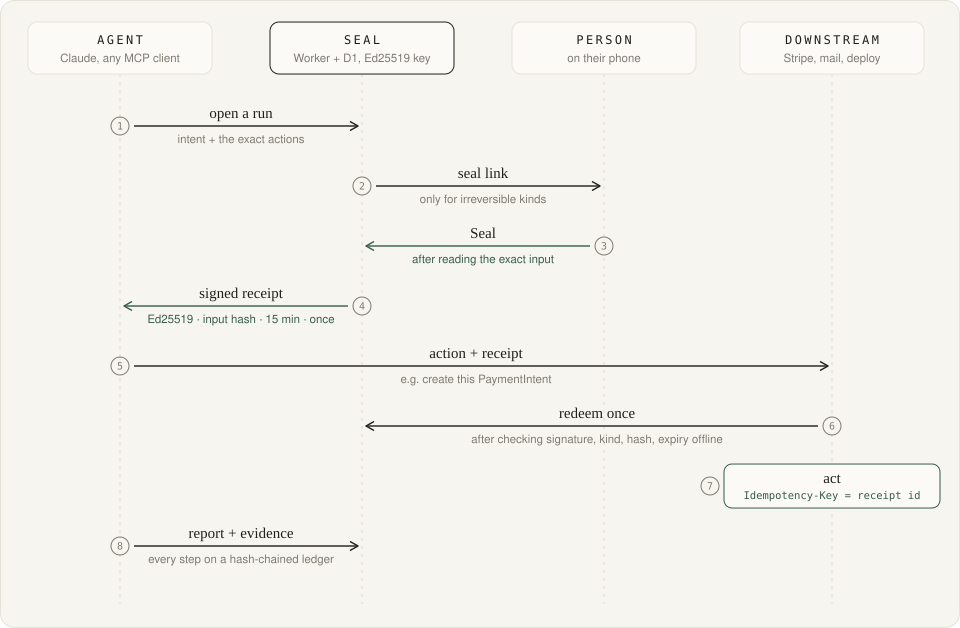
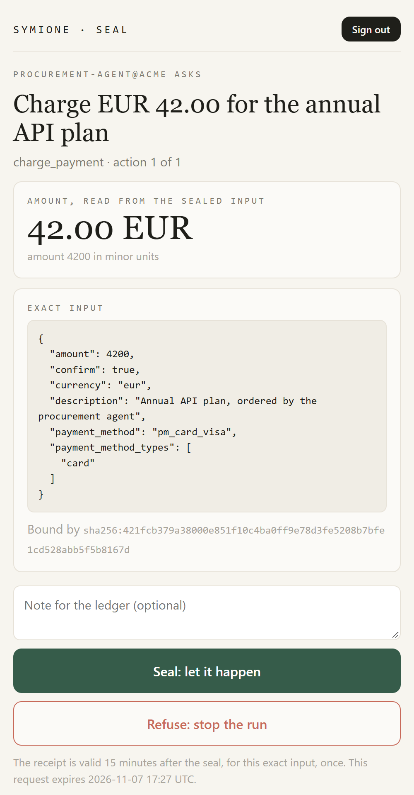

# SYMIONE SEAL

**An agent prepares an irreversible action. A person approves that exact action from their phone. The approval is an Ed25519 receipt bound to the SHA-256 of the action's input, valid for 15 minutes and redeemable once. Any downstream system can verify it before it acts.**

Charges, emails, deploys, signatures: the system that executes the action can check that a person authorized *this* amount, *this* recipient, *this* command. Every step lands on a hash-chained ledger. It ships as an MCP server and a dependency-free CLI, on Cloudflare Workers + D1.



## Payments: no PaymentIntent without a seal on its exact parameters



```sh
node clients/seal.mjs gate charge_payment "Charge EUR 42.00 for the annual API plan" examples/charge.json \
  | node examples/stripe-charge.mjs examples/charge.json
```

The first command opens the request and waits for the person. The second, [`examples/stripe-charge.mjs`](examples/stripe-charge.mjs), is the downstream:

1. It verifies the receipt offline against the Seal's published key: signature, issuer, kind, SHA-256 of these exact parameters, expiry.
2. It redeems the receipt once at the Seal.
3. It creates the PaymentIntent from the sealed parameters as they stand, with **the receipt id as the `Idempotency-Key`** and the receipt, run and input hash in `metadata`. The charge in the Dashboard points back to the person's decision.

The amount on the phone is computed from the sealed input: `4200` and `eur` read **42.00 EUR**, in minor units as Stripe counts them (JPY, KWD included). The agent's own summary is the title, never the figure.

That command against a local Seal, without a Stripe key:

```text
Receipt verified and redeemed. Dry run (no STRIPE_SECRET_KEY), the request:

POST https://api.stripe.com/v1/payment_intents
Idempotency-Key: rcpt_ze1vngtir87p1u4p

amount=4200
currency=eur
description=Annual+API+plan,+ordered+by+the+procurement+agent
payment_method=pm_card_visa
payment_method_types[0]=card
confirm=true
metadata[seal_receipt_id]=rcpt_ze1vngtir87p1u4p
metadata[seal_run_id]=run_9t8m3d37ey0v59rp
metadata[seal_input_hash]=sha256:421fcb379a38000e851f10c4ba0ff9e78d3fe5208b7bfe1cd528abb5f5b8167d
metadata[seal_sealed_at]=2026-11-06T17:30:13.818Z
```

With `STRIPE_SECRET_KEY=sk_test_…` it creates the PaymentIntent in test mode. The example refuses live keys.

<br clear="right">

## What it refuses

| Attempt | Result |
|---|---|
| The agent changes one cent after the seal | `RECEIPT_MISMATCH` before anything reaches Stripe: the hash covers every parameter |
| The same receipt twice | `RECEIPT_USED` at the Seal, and Stripe's idempotency would return the same PaymentIntent to a replay |
| A receipt sealed for an email, used for a charge | `RECEIPT_MISMATCH`: a receipt carries its kind |
| An approval used an hour later | `RECEIPT_EXPIRED` after 15 minutes |
| A summary saying EUR 4.20 over an input of `420000` | The phone shows 4,200.00 EUR, computed from the input |
| A secret inside a sealed input | Refused when the run opens: the person reads everything they seal, secrets pass by name (`env:STRIPE_KEY`) |
| A forged or cross-origin seal form | `403`: Origin check plus an HMAC form token per session and request |
| An edit to a past ledger event | `/api/ledger/verify` names the first sequence number that breaks |
| A flood of requests to bury the person | At most 10 seals wait at once, 3 open runs per agent, 20 in all |

Each line is covered in [`tests/`](tests): the real Worker over `node:sqlite`, spoken to over HTTP, with a mock Stripe that records what reaches it.

**Scope.** The Seal is a gate and a witness. It holds no credentials and performs no action. A system is protected where it checks a receipt before acting; an agent holding its own API key can still act without asking, and there the ledger records what was asked and decided. The ledger is tamper-evident: a SHA-256 chain over RFC 8785 canonical JSON, where changing one past event breaks every later hash. Chain heads are unsigned in v0.1.

## The receipt

```text
base64url(canonical JSON payload) "." base64url(Ed25519 signature over those exact bytes)
```

The payload of the receipt above:

```json
{
  "expires_at": "2026-11-06T17:45:13.818Z",
  "index": 0,
  "input_hash": "sha256:421fcb379a38000e851f10c4ba0ff9e78d3fe5208b7bfe1cd528abb5f5b8167d",
  "issuer": "http://127.0.0.1:8799",
  "kind": "charge_payment",
  "receipt_id": "rcpt_ze1vngtir87p1u4p",
  "run_id": "run_9t8m3d37ey0v59rp",
  "sealed_at": "2026-11-06T17:30:13.818Z",
  "sealed_by": "operator",
  "type": "symione.seal.receipt",
  "v": 1
}
```

The public key is served at `/.well-known/symione-seal.json`. [`clients/verify.mjs`](clients/verify.mjs) is the whole offline check in WebCrypto, with no dependencies (Node, Deno, Bun, browsers, Workers): copy it into any system that must refuse to act without a seal. A test holds its hash to the Worker's bytes.

## Use it

**From Claude Code, or any MCP client.** Five tools: `seal_policy`, `seal_open_run`, `seal_next`, `seal_report`, `seal_status`. The server instructs the agent to perform a sealed kind only after a `go` that carries a receipt.

```sh
claude mcp add --transport http seal https://<your-seal>/mcp --header "Authorization: Bearer $SEAL_AGENT_KEY"
```

**From a shell.** Seals the exact command line, runs that same string, and reports its exit code and last lines as evidence.

```sh
node clients/seal.mjs run deploy_production "Deploy release 1.4.2" "npx wrangler deploy"
```

**Policy.** Read and safe kinds go straight through (`read`, `search`, `draft`, `test`, `preview_deploy`…). Sealed kinds wait for the person: `charge_payment`, `send_email`, `send_message`, `sign_agreement`, `publish`, `deploy_production`, `push_main`, `delete_data`. Rules, states and API: [CONTRACT.md](CONTRACT.md).

## Run it

```sh
npm install
npm test                                   # the Worker over node:sqlite, real HTTP, mock Stripe
node scripts/make-secrets.mjs --local      # .dev.vars + private/SEAL_LOCAL.txt (operator password, agent key)
npx wrangler d1 migrations apply symione-seal --local
npx wrangler dev --port 8799
node scripts/smoke.mjs http://127.0.0.1:8799 private/SEAL_LOCAL.txt   # 18 end-to-end checks, the phone included
```

Deploy: `wrangler d1 create symione-seal --jurisdiction eu`, put the id in `wrangler.jsonc`, `wrangler d1 migrations apply symione-seal --remote`, `wrangler deploy`, then `node scripts/make-secrets.mjs --remote`. Running `make-secrets --remote` again rotates every secret: old receipts stop verifying and every session ends.

## Status

v0.1 runs in production on Cloudflare Workers + D1 (EU) since 3 November 2026, and the smoke suite passes against it. Next: signed chain heads, several people sealing one run, settlement on a conditional-payment rail.
